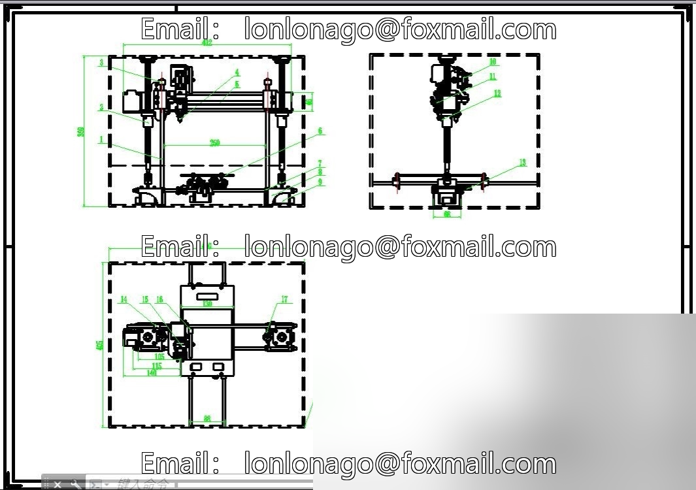
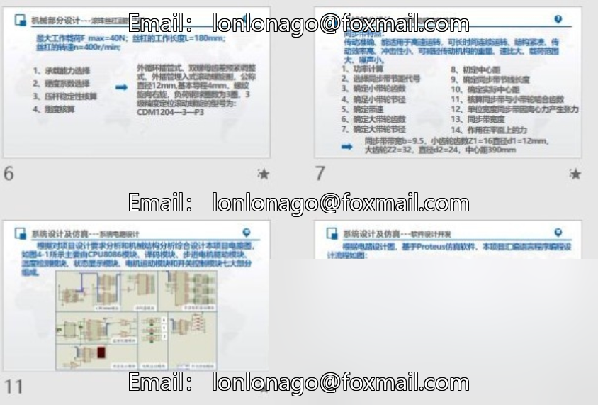
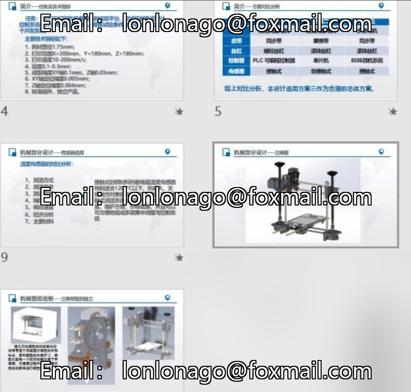
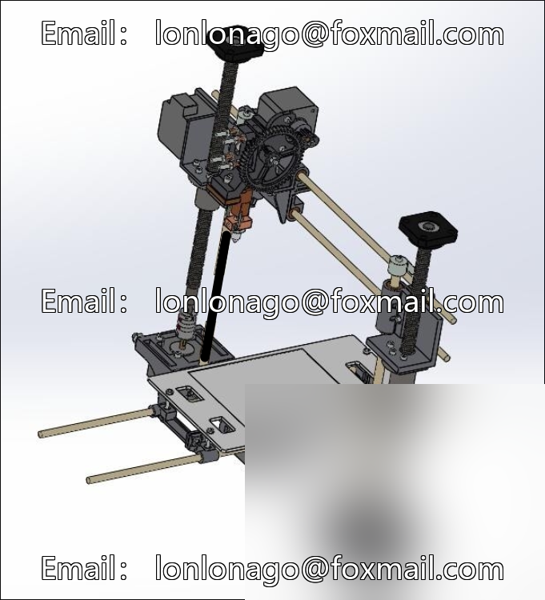

# 3D printer structural design atlas

## Body

3D printer structural design chart set 514 - 3D printer design; 3D printer design figures; 3D printer CAD diagrams; 3D printer three-dimensional figures; 3D printer three-dimensional figures 3D
3D printer structural design; 3D printer structural design figures; 3D printer structural design CAD diagrams; 3D printer structural design figures
This document contains a manual (mechanical design, system design, simulation, three-dimensional models, and drawing drawing) + 7 two-dimensional figures + three-dimensional models

This material includes 3D printer structural design content, covering mechanical design, system design, simulation, three-dimensional models, and drawing creation, along with two-dimensional and three-dimensional models.

<!-- AI_ENRICHED -->

## Images

## Payment

Here is a pay link on Stripe ( https://buy.stripe.com/3cs8yP7sY87d0vu9AB ). Please contact me lonlonago@foxmail.com after funding $89, and I will send you a complete data files , thank you!

